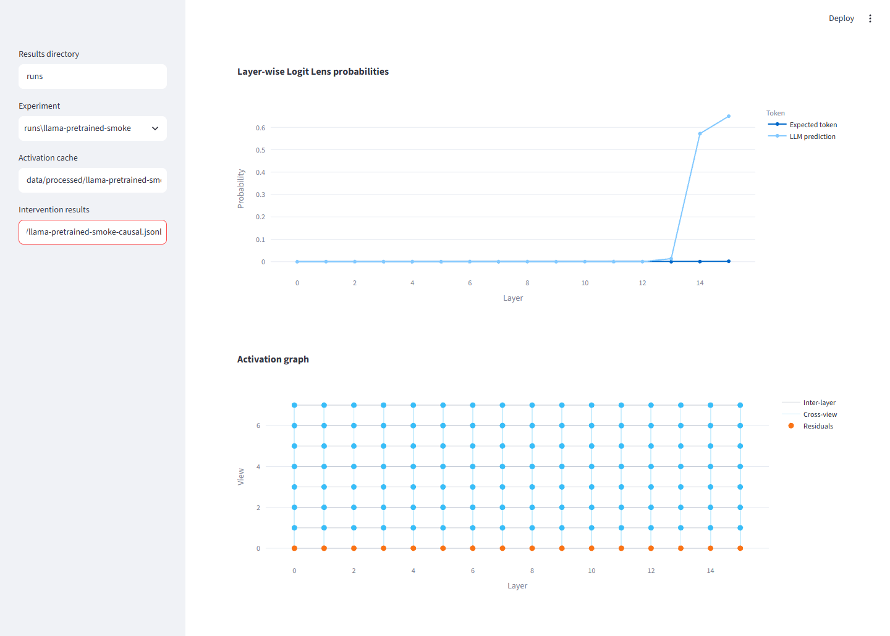

# TRACE-K

**Tracing and Recovering Accessible Concealed Knowledge in Large Language Models**

TRACE-K measures whether factual answers can be recovered from a frozen language model's activations and whether scaling selected MLP neurons changes next-token predictions. It compares single-prompt and multi-prompt probes against graph and graph-free baselines. A graph node represents a decoder layer at the last input token of one paraphrase.

[Run the project](#run-pararel) · [Methods](#methods) · [Executed experiments](#executed-experiment-matrix) · [Results](#local-verification) · [Dashboard](#dashboard)

## Install

Use Python 3.10 or later and a CUDA-enabled PyTorch build for GPU experiments. Run these commands from the repository root.

```powershell
python -m pip install -r requirements.txt
python -m pytest -q
trace-k --help
```

For the default model, request access to Llama 3.2 1B and sign in with `hf auth login` if needed. The model ID may also point to a local checkpoint. CUDA defaults to BF16 and CPU to FP32. The decoder must expose Llama-style blocks, RMS normalization, and MLP down projections. [Llama documentation](https://huggingface.co/docs/transformers/model_doc/llama)

## Run ParaRel

```powershell
git clone --depth 1 https://github.com/yanaiela/pararel.git data/raw/pararel
trace-k prepare data/raw/pararel data/processed/facts.jsonl --views 8 --behavior-views 1
trace-k split data/processed/facts.jsonl data/splits/fact --mode fact --limit 1500
trace-k extract data/splits/fact data/processed/cache --device cuda --batch-size 4
trace-k behavior data/processed/cache runs/behavior.json
trace-k train data/processed/cache runs/rgcn --config configs/graph.yaml --device cuda
trace-k suite data/processed/cache runs/suite --config configs/graph.yaml --device cuda
trace-k importance data/processed/cache runs/rgcn/probe.pt runs/importance.jsonl --device cuda
trace-k causal data/processed/cache runs/causal.jsonl --importance runs/importance.jsonl --device cuda
python -m streamlit run dashboard/app.py
```

The converter reads the official ParaRel pattern and T-REx files. It renders the prefix preceding the object placeholder and keeps patterns whose subject occurs before the object. Each fact includes up to 32 reproducibly sampled relation-matched negatives. Partitioning deduplicates facts and excludes rendered prompts associated with multiple distinct facts. [ParaRel repository](https://github.com/yanaiela/pararel)

Use a smaller `--limit` for a smoke run. The limit is applied before tokenization. The final count depends on how many candidate facts have valid one-token continuations across their prompts. Input suffixes include a leading space. Recorded metrics concern the first generated token over the full vocabulary. Pairwise accuracy uses the subset of sampled negatives that also tokenize as a single continuation.

The extraction cache stores BF16 residuals and embeddings, Logit Lens measurements, model provenance, the tokenizer, and a single frozen output head. The LM is released before probe training. Each run uses a new output directory. Checkpoints are selected by validation MRR. A report contains validation history, held-out metrics, and the base model's behavior. Use the dashboard to compare runs, inspect per-prompt evidence, view activation graphs and entropy across layers, and inspect intervention outcomes.

### Paired Llama benchmark

```powershell
trace-k suite data/processed/llama-pararel runs/llama-benchmark --device cuda --epochs 3 --batch-size 8 --variants linear deepsets rgcn single residual_linear residual_rgcn
trace-k compare runs/llama-benchmark/residual_linear runs/llama-benchmark/residual-comparison.json runs/llama-benchmark/residual_rgcn
```

All probes use the same cached prompts and the same test targets. The two residual probes reconstruct frozen logits from the original final-layer residual and the fixed RMS norm and vocabulary head. A zero-initialized projection adds a learned correction before unembedding. The correction's L2 norm is capped at 15% of the normalized frozen state. The linear version uses the target view's final state as its input and controls for the effect of adding the correction without graph aggregation. Frozen accuracy in the reports uses the original cached model predictions.

Each training report gives separate metrics for answers whose gold token was present or absent from the probe's training set. Accuracy changes are paired on the same prompts. The 95% intervals use 2,000 bootstrap draws that resample facts together with all their paraphrases. These intervals quantify held-out fact sampling variation within a run. For a stricter check on novel answers, use `trace-k split --mode object` with the same pool of facts, extract the resulting partitions, and run both residual probes on that cache.

### Import another factual dataset

Pass a UTF-8 JSONL file directly to `trace-k split`. Each row needs a unique fact identifier, subject, relation, expected object, and a list of paraphrases ending immediately before the answer. Provide matching template strings for template-disjoint experiments. Negative candidates and the behavior-only views are optional. Match each behavior prompt to a behavior template if running a template-disjoint experiment.

```json
{"fact_id":"capital-de","subject":"Germany","relation":"capital","object":"Berlin","paraphrases":["The capital of Germany is","Germany's capital city is"],"templates":["The capital of [X] is","[X]'s capital city is"],"negative_candidates":["Paris","Rome"]}
```

## Methods

### Research question and prediction task

TRACE-K asks how much factual answer information a frozen decoder exposes in its internal activations, whether a graph over layers and paraphrases helps extract that information, and how a targeted activation intervention changes the decoder's output. The supervised prediction task is **full-vocabulary next-token ranking**. Each fact $f=(s,r,o)$ has several prompts $p_{f,v}$ and one gold token $y_f$. A probe prediction counts as correct when its highest-scoring token ID equals $y_f$. The experiment therefore covers single-token completions and uses token-ID exact match throughout.

### Dataset construction and leakage controls

The ParaRel converter joins T-REx facts with relation templates. In each template it retains the prefix before the object placeholder and substitutes the subject into it. The standard run uses eight graph views and one extra behavioral view per eligible fact. The extra prompt is evaluated by the frozen decoder and contributes to the evidence labels. Its activations are excluded from the probe graph. Up to 32 reproducibly sampled objects from the same relation provide evaluation negatives. The converter and tokenizer filtering retain negatives only when their token IDs are valid alternative continuations.

A gold answer is accepted when appending it with one leading space preserves the original prompt tokens and produces exactly one new non-special token with a consistent ID across the fact's prompts. Partitioning deduplicates normalized facts and excludes exact rendered prompts shared by distinct facts. The seeded splitter assigns groups to train, validation, and test in approximately 70/15/15 proportions by group count. Fact grouping keeps all paraphrases of a fact together. Subject-, relation-, and object-disjoint modes group by the corresponding field. Template-disjoint mode assigns templates to distinct partitions and filters views after splitting facts. The audit checks fact identifiers, normalized triples, rendered prompts, and the field required by the requested split. A separate evaluation breakdown checks gold **token** overlap because identical tokens can arise from different answer strings.

The fact-disjoint and object-disjoint Llama runs started from the same prepared pool and used a limit of 1,500 facts per split protocol before token filtering. Source and filtering logic are in [data.py](src/trace_k/data.py) and [llm.py](src/trace_k/llm.py).

### Frozen decoder and activation cache

For prompt $p_{f,v}$, let $t_{f,v}$ be its final non-padding input position. A forward hook reads each decoder block's output before the model's final RMS normalization:

$$
h_{f,v,\ell}=H^{(\ell)}(p_{f,v})_{t_{f,v}},\qquad
x_{f,v,\ell}=h_{f,v,\ell}.
$$

A left-padding mask and explicit position IDs place the last valid token correctly in each batch. The decoder runs in evaluation mode with frozen weights. Probes train separately on cached BF16 residual states. The cache also stores input embeddings, per-layer Logit Lens summaries, frozen next-token outcomes, and the fixed output-head parameters. Answer IDs and negatives enter supervision or evaluation. The graph inputs consist of model activations and, optionally, statistics derived from them.

Write $U$ for the frozen output matrix and $b_U$ for its bias, when present. The Logit Lens uses the frozen final RMS normalization with scale $g$:

$$
N(h)=g\odot\frac{h}{\sqrt{d^{-1}\sum_{j=1}^{d}h_j^2+\epsilon}},\qquad
z^{\mathrm{lens}}_{f,v,\ell}=U N(h_{f,v,\ell})+b_U.
$$

The intermediate Logit Lens baseline chooses the best intermediate block by **validation top-1 accuracy**. Test outcomes are then reported for that fixed block. The final-layer reference in paired reports comes from the decoder's original forward pass. The residual probes reconstruct it in FP32 from the cached states, so finite-precision differences are measured separately below.

### Paraphrase–layer graph

A node $(v,\ell)$ represents one view at one decoder block. A multi-view example contains all retained graph views of the fact, and a single-view example contains just the target prompt. A complete eight-view, 16-layer Llama graph has 128 nodes. A training or evaluation example selects one target view $v_\star$. Its anchor $a$ is that view's node at the deepest retained layer. Batches concatenate graphs as disjoint components.

| Relation | Directed edge construction | Weight |
| --- | --- | --- |
| Inter-layer | Both directions between consecutive retained decoder blocks of the same view | 1 |
| Cross-view | Every ordered pair of distinct views at the same block | 1 |
| Similarity, optional | Up to three highest-cosine incoming neighbors per node, excluding self-edges and nonpositive scores | Positive cosine similarity |

Training drops each non-target view independently with probability $0.15$ by default and keeps the target view. Evaluation uses all views permitted by the configuration. Residual states are the default features. The statistics ablation adds normalized depth, activation L2 norm, the fraction of components with magnitude below $10^{-3}$, cosine similarity to the previous block, and Logit Lens entropy. The embedding control repeats each view's final-position input embedding across its retained layer nodes. Optional PCA fits on a bounded sample from the training partition and applies the same centering and projection to every split.

The random-graph control attempts edge swaps $(a,b),(c,d)\mapsto(a,d),(c,b)$ independently within each relation. Successful swaps preserve each node's in-degree and out-degree by relation while excluding self-edges and duplicate edges. These graph relations are probe design choices. The intervention experiment tests the original decoder separately. [Graph construction](src/trace_k/graph.py)

### R-GCN and answer prediction

The default graph input projection maps $d\to256\to128$ with GELU between the two affine maps. Three message-passing blocks use a separate neighbor transform for each edge relation. With $\mathcal N_r(i)$ denoting incoming neighbors for relation $r$ and $w_{ji}$ the edge weight, a block computes:

$$
m_i^{(k)}=W_0^{(k)}u_i^{(k)}+b_0^{(k)}
+\sum_r\sum_{j\in\mathcal N_r(i)}
\frac{w_{ji}}{\sum_{q\in\mathcal N_r(i)}w_{qi}}W_r^{(k)}u_j^{(k)},
\qquad
u_i^{(k+1)}=u_i^{(k)}+\mathrm{GELU}(\mathrm{LayerNorm}(m_i^{(k)})).
$$

An empty incoming relation contributes zero. After the last block, the anchor conditions a softmax over the nodes of its own graph:

$$
\alpha_i=\mathrm{softmax}_{i\in V_f}
\left(\frac{(Q u_a)^\top u_i}{\sqrt{128}}\right),
\qquad c_f=\sum_{i\in V_f}\alpha_i u_i.
$$

The standard probe predicts full-vocabulary logits $z=U(W_c c_f+b_c)+b_U$. The Linear Probe replaces graph readout with an affine projection of the anchor state. The MLP baseline adds a nonlinear transformation of that anchor. DeepSets applies a shared node transform and mean pooling. Transformer pooling applies self-attention within each graph's nodes, then anchor-conditioned readout. GCN uses symmetric degree normalization, GraphSAGE uses a weighted incoming mean, and the GATv2-style variant learns edge weights from source and destination features. The suite also includes an approximately parameter-matched MLP.

### Residual probes and optimization

The residual probes retain a direct path from the decoder's final target state to its frozen vocabulary head. Let $s=N(h_{f,v_\star,L-1})$ and let $\delta=W_c c_f+b_c$ be the probe's learned correction. The output projection is initialized to zero and the correction is norm-capped:

$$
\widetilde\delta=\delta\min\!\left(1,\frac{0.15\lVert s\rVert_2}
{\max(\lVert\delta\rVert_2,10^{-8})}\right),
\qquad
z_{\mathrm{res}}=U(s+\widetilde\delta)+b_U .
$$

The cap constrains the size of the correction in hidden space. Residual Linear uses only the target's last-layer state in its learned branch. This provides a control for the contribution of the residual path and a paired comparison for the added graph. The frozen vocabulary head and RMS norm receive no optimizer updates.

Every graph view serves as a target during training. AdamW minimizes full-vocabulary cross-entropy, $\mathcal L=-\log\mathrm{softmax}(z)_{y_f}$, with learning rate $10^{-3}$ in the listed runs. The Tuned Lens control instead learns a zero-initialized residual affine translator at the middle block and minimizes $\mathrm{KL}(p_{\mathrm{final}}\|p_{\mathrm{translated}})$ against the frozen final distribution with the same norm and vocabulary head. Checkpoint selection uses validation MRR. The test set provides the final reported metrics. [Probe implementation](src/trace_k/probe.py) · [Training and evaluation](src/trace_k/train.py)

### Evaluation and uncertainty

For target prompt $i$ with gold token $y_i$, let $\widehat y_i$ be the probe argmax, $b_i$ the frozen decoder argmax, and $R_i$ the full-vocabulary rank of $y_i$. Tied logits are ordered by token ID. The key quantities are:

$$
\begin{aligned}
\mathrm{Accuracy}&=\frac1n\sum_i\mathbf1[\widehat y_i=y_i],\\
\text{Hits@}k&=\frac1n\sum_i\mathbf1[R_i\le k],\qquad
\mathrm{MRR}=\frac1n\sum_i R_i^{-1},\\
\mathrm{Recovery}&=\frac{\sum_i\mathbf1[b_i\ne y_i,\,\widehat y_i=y_i]}{\sum_i\mathbf1[b_i\ne y_i]},\\
\mathrm{Regression}&=\frac{\sum_i\mathbf1[b_i=y_i,\,\widehat y_i\ne y_i]}{\sum_i\mathbf1[b_i=y_i]}.
\end{aligned}
$$

Pairwise accuracy is the fraction of sampled gold–negative pairs with a strictly higher gold score. ECE uses ten equal-width top-confidence bins and weights each bin's absolute accuracy–confidence gap by its prompt count. Paraphrase consistency is the fraction of facts with at least two views for which all target predictions agree. Synthetic exposure AUROC ranks exposed versus unexposed prompts by the gold-token probability when both classes are present. Recovery and regression are reported as unavailable when their respective denominators are zero.

The paired accuracy comparison averages $\mathbf1[\widehat y_i=y_i]-\mathbf1[\widehat y_i^{\,\mathrm{ref}}=y_i]$ on identical test prompts. The reference is either the frozen decoder or another probe. Confidence intervals use the 2.5th and 97.5th percentiles from 2,000 bootstrap draws of **fact IDs**, taking all views together with each sampled fact. These intervals describe held-out sampling variation for the fitted checkpoints. Separate training seeds assess sensitivity to initialization and training order.

Per-prompt evidence labels follow a fixed priority. **Expressed Knowledge** means the frozen model answers the target correctly. **Accessible but Inconsistent** means it answers another paraphrase correctly, including a behavioral view. **Internally Decodable** means the probe recovers the answer after the frozen decoder misses all evaluated views. **No Evidence Found** is the remaining case.

### Layer importance and controlled decoder intervention

Layer importance removes all nodes at one layer from the validation graphs and measures the mean gold-probability decrease:

$$
I_\ell=\mathbb E_{i\in\mathrm{val}}
\big[p_{\mathrm{probe}}(y_i\mid G_i)-p_{\mathrm{probe}}(y_i\mid G_i\setminus V_\ell)\big].
$$

The top-ranked validation layer can then be selected for intervention. For a held-out prompt, fix the foil $q$ as the highest-scoring non-gold token in the original decoder forward pass. Let $a$ be the input of the selected block's MLP down projection at the last prompt token. The attribution target is the logit margin $m(a)=z_y(a)-z_q(a)$. The default attribution is gradient times activation:

$$
A_j=a_j\frac{\partial m(a)}{\partial a_j}.
$$

With more than one integration step, the implementation estimates Integrated Gradients from zero by averaging the gradient along the zero-to-$a$ path at uniformly spaced midpoints. It selects neurons by absolute attribution, scales each selected component by gain $\gamma$, then runs the decoder again:

$$
a_j'=
\begin{cases}
\gamma a_j,&j\in S,\\
a_j,&j\notin S,
\end{cases}
\qquad
\Delta m=m(a')-m(a).
$$

The selected gold and foil IDs remain fixed for the before–after margin. Controls use random neurons in the same layer, nearest absolute activation magnitudes among unselected neurons, random neurons in another layer, and the selected indices transferred to an unrelated fact. The summary groups by condition and gain, averaging margin changes and recording top-1 correction and regression on the corresponding baseline subsets. Gain 1 provides an identity control. The neuron selection uses gold labels during analysis, making this a label-informed intervention measurement. [Causal implementation](src/trace_k/causal.py)

### Executed experiment matrix

| Run | Design and question |
| --- | --- |
| Llama fact-disjoint benchmark | Pretrained Llama 3.2 1B, 1,486 retained facts, three epochs, eight facts per training batch, seed 42. Compares frozen decoder, validation-selected intermediate Logit Lens, Linear Probe, DeepSets, single- and multi-view R-GCN, and both residual probes on the same held-out targets. |
| Llama object-disjoint benchmark | Same base checkpoint and 1,486 retained facts, with separate object-disjoint partitions. Compares frozen decoder, intermediate Logit Lens, Linear Probe, and both residual probes. Gold test token overlap with probe training was zero. |
| Llama seed repeat | Repeats the two residual probes on the fact-disjoint split with seed 17. Uses the same three-epoch schedule and evaluation targets. |
| SmolLM2 larger run | Pretrained SmolLM2-135M with 1,320 retained ParaRel facts. Measures three-epoch multi-view R-GCN recovery and regression against the frozen decoder. |
| SmolLM2 smoke suite | One-epoch comparisons on 32 held-out prompts spanning probe architectures and ablations. Includes edge-type removal, random rewiring, layer and feature changes, disabling view dropout, shuffled labels, PCA, and matched randomly initialized decoder weights. |
| Llama and SmolLM2 causal smoke runs | Each uses 24 source prompts, eight selected neurons, gradient × activation, five conditions, and gains 0, 1, and 2. Each produces 360 intervention records, including identity-gain measurements. |
| Synthetic exposure smoke run | Generates 40 artificial facts with opaque subjects and approximately balanced random answers. Trains a rank-8 LoRA adapter with alpha 16 on query and value projections using only marked exposed facts for three epochs. Trains a separate one-epoch probe with each decoder checkpoint on the same synthetic split and compares exposure AUROC on 24 test prompts. |

The synthetic exposure protocol permits a fact to be exposed to the decoder during adapter training while held out from probe training. Exposure indicates which synthetic facts the adapter was allowed to see. The untreated pretrained checkpoint and unexposed synthetic facts provide comparison conditions. [Synthetic adapter](src/trace_k/synthetic_adapter.py)

## Experimental controls

- **Splits** — `--mode subject`, `relation`, `object`, and `template` each create a separate partition set. Template mode assigns templates to partitions and filters the graph and held-out behavior views of independently partitioned facts. Its view count can vary.
- **Probes** — Linear and MLP baselines use the target residual. DeepSets and Transformer pooling aggregate nodes. GCN, GraphSAGE, GATv2-style attention, and R-GCN use the same graph inputs. The Tuned Lens baseline learns a residual affine translator at the middle decoder layer by distilling the frozen model's final distribution. [Tuned Lens](https://arxiv.org/abs/2303.08112)
- **Graph ablations** — The suite compares single and multiple views, relation removal, degree-preserving rewiring, alternative layer subsets, input embeddings, statistical features, view dropout, shuffled training labels, similarity edges, and train-only PCA. Each result includes trainable parameter counts and an approximately parameter-matched MLP control.
- **Random frozen model** — Run `trace-k extract data/splits/fact data/processed/random-cache --random-weights`, then supply `--random-cache data/processed/random-cache` to a new suite run. Use the same model ID, revision, and splits.
- **Causal checks** — Layer removal ranks layers using validation data. The intervention uses test prompts, measures the gold versus strongest non-gold logit margin, and scales selected inputs to the MLP down projection at the last prompt token. `--steps 1` uses gradient × activation. Larger values approximate Integrated Gradients from zero. The report compares random neurons, activation-matched neurons, another layer, and transferred indices on unrelated facts. Gain 1 is the identity control. [Activation patching evaluation](https://arxiv.org/abs/2309.16042)

### Synthetic exposure

```powershell
trace-k synthetic data/synthetic/facts.jsonl --count 120
trace-k split data/synthetic/facts.jsonl data/splits/synthetic
trace-k adapt data/synthetic/facts.jsonl runs/synthetic-adapter --epochs 6
trace-k extract data/splits/synthetic data/processed/synthetic-base
trace-k extract data/splits/synthetic data/processed/synthetic-adapted --adapter runs/synthetic-adapter
trace-k train data/processed/synthetic-base runs/synthetic-base
trace-k train data/processed/synthetic-adapted runs/synthetic-adapted
```

Synthetic answer assignments are shuffled and approximately balanced. The adapter sees the marked facts, including exposed facts held out from probe training. It never trains on unexposed facts. Compare exposure AUROC and next-token behavior between the base and adapted caches. Confirm that the adapter learned the exposed facts before interpreting the comparison.

## Interpretation

The main metric is recovery rate among prompts the frozen LLM answered incorrectly. Reports also include MRR, Hits@1, Hits@5, pairwise accuracy, ECE, paraphrase consistency, and regression on originally correct prompts. A recovered answer provides evidence of decodability under the chosen probe. Success using multiple views can depend on evidence unique to other paraphrases. An intervention tests the effect of modifying current activity under a specific prompt and a label-informed neuron selection procedure. An empty evidence category cannot establish absence of knowledge.

The main protocol supports single-token answers on decoder-only models with Llama-style internals. Multi-token sequence ranking, multilingual evaluation, sparse feature graphs, and circuit discovery are research extensions.

## Local verification

The end-to-end tests use a small local Llama decoder and can run without downloading model weights. The CUDA runs below used local pretrained checkpoints and ParaRel data unless otherwise indicated.

### Expanded Llama 3.2 1B results

Each partitioning protocol retained 1,486 single-token facts across train, validation, and test. The fact-disjoint test included 1,768 prompts from 221 facts. The object-disjoint test included 1,856 prompts from 232 facts and had zero overlap with the training answer tokens. Probe checkpoints were selected on validation MRR after three training epochs.

| Approach | Fact-disjoint top-1 | Fact-disjoint recovery | Fact-disjoint regression | Object-disjoint top-1 |
| --- | ---: | ---: | ---: | ---: |
| Frozen Llama | 17.25% | — | — | 28.99% |
| Intermediate Logit Lens, layer index 13 | 14.82% | 6.97% | 47.54% | 25.27% |
| Linear probe | 36.03% | 27.41% | 22.62% | 0.65% |
| DeepSets | 27.15% | 24.06% | 58.03% | — |
| R-GCN, single view | 35.80% | 30.21% | 37.38% | — |
| R-GCN, multiple views | 34.84% | 28.09% | 32.79% | — |
| Residual linear | 53.11% | 44.16% | 3.93% | 46.55% |
| Residual R-GCN | 54.36% | 45.59% | 3.61% | 47.41% |

Recovery is measured among prompts the frozen model answered incorrectly. Regression is measured among prompts it answered correctly. The table reports seed 42. The intermediate Logit Lens layer was selected on validation accuracy. A dash marks an unrun comparison or a metric that uses the frozen model itself as the reference.

On the 33 fact-disjoint test facts with unseen gold tokens, frozen accuracy was 6.44%. Standard probes reached 0% on those prompts. Residual linear and residual R-GCN reached 22.35% and 19.70%, respectively. The object-disjoint results replicate the residual approach's improvement on a larger set of unseen answers, where residual R-GCN gained 18.43 percentage points over frozen Llama (95% fact-bootstrap interval +14.49 to +22.41).

The residual R-GCN advantage over residual linear was +1.24 points on the fact-disjoint test (95% interval −1.02 to +3.62) and +0.86 points on the object-disjoint test (−1.08 to +2.75). Both intervals include zero. See the local [fact-disjoint comparison](runs/llama-benchmark/residual-comparison.json) and [object-disjoint comparison](runs/llama-object-benchmark/residual-comparison.json).

Repeating the fact-disjoint residual comparison with seed 17 yielded 54.98% for residual linear and 55.15% for residual R-GCN. The graph advantage was +0.17 points (95% interval −1.64 to +2.09). See the [second-seed comparison](runs/llama-benchmark-seed17/residual-comparison.json).

Reconstructing logits in FP32 from cached BF16 states changed the frozen argmax on 44 of 1,768 fact-disjoint prompts and 32 of 1,856 object-disjoint prompts. The resulting accuracy differences were +0.68 and +0.43 points. See the [fact-disjoint reconstruction check](runs/llama-benchmark/reconstruction.json) and [object-disjoint reconstruction check](runs/llama-object-benchmark/reconstruction.json).

### Earlier held-out results

| Run | Test prompts | Frozen LLM accuracy on those prompts | R-GCN accuracy | MRR | Recovery on failed prompts |
| --- | ---: | ---: | ---: | ---: | ---: |
| SmolLM2-135M, 1,320 facts across splits, 3 epochs | 1,576 | 5.84% | 13.71% | 0.2537 | 216/1,484 (14.56%) |
| Llama 3.2 1B smoke test, 29 facts across splits, 2 epochs | 32 | 28.13% | 0.00% | 0.1571 | 0/23 (0.00%) |

Frozen accuracy uses the same target prompts as the probe. R-GCN missed all 92 originally correct SmolLM2 prompts and all nine originally correct Llama prompts in these runs. See the local [SmolLM2 report](runs/smollm-pararel-rgcn/metrics.json) and [Llama report](runs/llama-pretrained-smoke/metrics.json). Run reports are generated locally under the gitignored `runs/` directory.

The one-epoch SmolLM2 smoke suite completed 24 configurations, including the random-weight control. On its 32 test prompts, multi-view R-GCN reached 3.13% accuracy, single-view R-GCN reached 18.75%, and DeepSets reached 25.00%. Removing cross-view edges yielded the highest MRR in that suite (0.3764). These comparisons are limited to the smoke sample.

The Llama smoke test ranked all 16 layers by validation-set importance and recorded 360 intervention measurements on 24 source prompts with five conditions and three gains. Attributed neuron scaling at gains 0 and 2 corrected zero failed predictions in this sample. Both gains also reversed 2 of the 9 originally correct predictions for the attributed condition. The SmolLM2 causal smoke test recorded 360 measurements and likewise found zero corrections for attributed neuron scaling. See the local [Llama causal summary](runs/llama-pretrained-smoke-causal.summary.json) and [SmolLM2 causal summary](runs/smollm-smoke-causal.summary.json).

The synthetic LoRA smoke test used 40 facts and 24 test prompts. Exposure AUROC was 0.25 with the base checkpoint and 0.75 with the adapted checkpoint. R-GCN top-1 accuracy was 0% for both. See the local [base report](runs/smollm-synthetic-base/metrics.json) and [adapted report](runs/smollm-synthetic-adapted/metrics.json).

### Dashboard

The screenshot shows the layer-wise Logit Lens probabilities and activation graph for a held-out prompt from the Llama 3.2 1B smoke run.



### Experiments still pending

| Experiment | Current status |
| --- | --- |
| Llama graph ablations | The expanded benchmark covers paired baselines and single-view R-GCN. Degree-preserving rewiring and relation-removal controls on the expanded Llama samples remain pending. |
| Full-scale SmolLM2 comparisons | R-GCN completed on 1,320 facts. The paired baseline and ablation suite has been run at smoke scale. |
| Subject-, relation-, and template-disjoint generalization | Partitions were built and checked for overlap. Extraction, training, and evaluation on those partitions remain pending. The separate object-disjoint benchmark is complete. |
| Causal robustness and synthetic exposure | Initial runs completed. Larger test samples, additional seeds, and systematic intervention sweeps remain pending. |
| Additional models and datasets | Llama 3.2 3B and the proposed alternative datasets have yet to be benchmarked. |

For the local Llama checkpoint, pass `--model-id data/raw/llama-3.2-1b` to `trace-k extract`. The downloaded weights were verified against the published file hash for revision `4e20de362430cd3b72f300e6b0f18e50e7166e08`.
