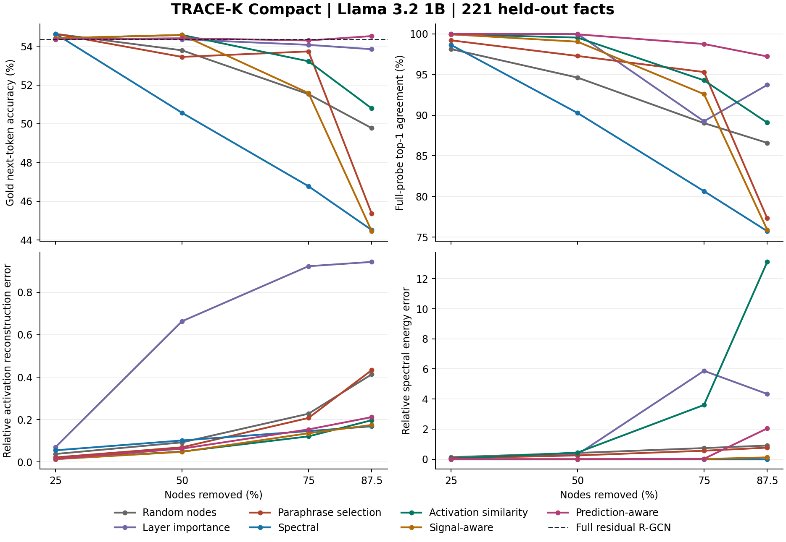

# TRACE-K Compact results

[Experiment protocol and structural prediction bound](protocol.md)

## Uncapped Llama 3.2 1B benchmark

The prepared ParaRel pool contains 6,803 facts. Deduplication and prompt ambiguity filtering retain 6,581 candidates. The Llama single-token filter retains 6,524 facts split into 4,569 training, 979 validation, and 976 test facts. The 976 test facts yield 7,808 target prompts. All three residual probes train for one epoch with seed 42, an eight-fact batch, the same frozen vocabulary head, and a correction cap of 15%.

| Probe | Trainable parameters | Gold accuracy | MRR | Difference from R-GCN (95% CI, percentage points) |
|---|---:|---:|---:|---:|
| Frozen Llama | — | 15.65% | 0.2597 | — |
| Residual R-GCN | 1,035,904 | 54.26% | 0.6323 | Reference |
| Residual DeepSets | 559,488 | 53.18% | 0.6221 | −1.09 [−1.93, −0.27] |
| Residual Transformer | 609,024 | 54.70% | 0.6334 | +0.44 [−0.15, +1.04] |

The controls share the training protocol and use different parameter counts. The Transformer comparison leaves the relative accuracy unresolved at this sample size and training budget. [Full probe control metrics](full-controls.json)

### Frozen-decoder extraction

The RTX 5070 processed 58,716 prompts, including the behavior-only views. Representation collection took 426.49 s and total extraction took 531.37 s, with 2.50 GiB peak CUDA allocation. The full activation cache occupies 4.38 GiB on disk, including the shared head and extraction diagnostics. Other GPU jobs were active during part of extraction. Every method uses this same upstream workload.

The local Llama weight file SHA-256 was `68a2e4be76fa709455a60272fba8e512c02d81c46e6c671cc9449e374fd6809a`. The prepared fact JSONL SHA-256 was `02079d081e78c06cd58ff71308ec15aaef78e77c8fd0414ba80efe9feceb3625`.

## Three-epoch benchmark on 1,486 facts

This run reuses the repository's limited fact-disjoint ParaRel split and its pretrained Llama 3.2 1B activation cache. The split contains 1,041 training, 224 validation, and 221 test facts. Each test fact contributes eight target prompts. Frozen Llama accuracy is 17.25%. The full residual R-GCN reaches 54.36% gold next-token accuracy and 0.6262 MRR.

| Method | 96 nodes | 64 nodes | 32 nodes | 16 nodes |
|---|---:|---:|---:|---:|
| Random nodes | 54.64% | 53.79% | 51.53% | 49.77% |
| Layer importance | 54.36% | 54.36% | 54.07% | 53.85% |
| Paraphrase selection | 54.64% | 53.45% | 53.73% | 45.36% |
| Spectral | 54.64% | 50.57% | 46.78% | 44.51% |
| Activation similarity | 54.41% | 54.58% | 53.22% | 50.79% |
| Signal-aware | 54.41% | 54.58% | 51.58% | 44.46% |
| Prediction-aware | 54.36% | 54.41% | 54.30% | 54.52% |

At 16 nodes, Prediction-aware agrees with the full probe on 97.23% of prompts. Its paired accuracy difference is +0.17 percentage points, with a 95% fact-bootstrap interval of −0.57 to +0.85. Spectral coarsening preserves the diagnostic spectral modes almost exactly and reaches 75.74% Top-1 agreement at that budget. The spectral diagnostic measures the modes used by that method, so good energy preservation can coexist with changes in predictions.

| Retrained control | Gold accuracy | Difference from full R-GCN (95% CI, percentage points) |
|---|---:|---:|
| Residual DeepSets | 52.26% | −2.09 [−4.13, −0.28] |
| Residual Transformer | 53.34% | −1.02 [−2.55, +0.45] |
| Without cross-view edges | 53.90% | −0.45 [−1.58, +0.57] |
| Without inter-layer edges | 52.55% | −1.81 [−3.51, −0.34] |
| Degree-preserving rewiring | 52.88% | −1.47 [−2.83, −0.11] |
| Last layer only | 51.87% | −2.49 [−4.75, −0.34] |
| Middle layers only | 54.75% | +0.40 [−0.85, +1.64] |

This run's GPU timings were collected while other GPU jobs were active. Use its accuracy and preservation metrics for the paired comparisons. [Compact metrics](benchmark-1486.json) · [Retrained control metrics](controls-1486.json)

