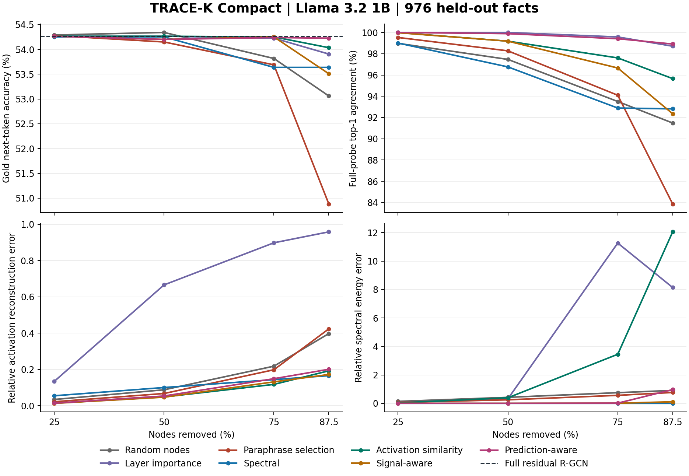
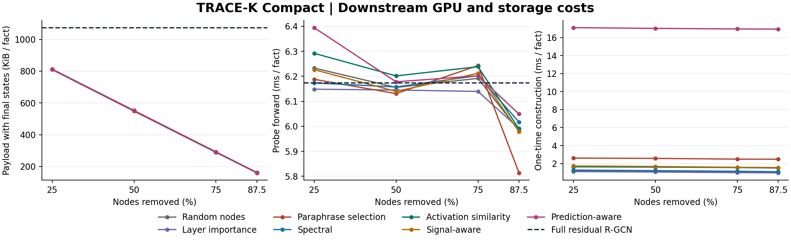

# TRACE-K Compact results

[Experiment protocol and structural prediction bound](protocol.md)

## Uncapped Llama 3.2 1B benchmark

The prepared ParaRel pool contains 6,803 facts. Deduplication and prompt ambiguity filtering retain 6,581 candidates. The Llama single-token filter retains 6,524 facts split into 4,569 training, 979 validation, and 976 test facts. The 976 test facts yield 7,808 target prompts. All three residual probes train for one epoch with seed 42, an eight-fact batch, the same frozen vocabulary head, and a correction cap of 15%.

| Probe | Trainable parameters | Gold accuracy | MRR | Difference from R-GCN (95% CI, percentage points) |
|---|---:|---:|---:|---:|
| Frozen Llama | — | 15.65% | 0.2597 | — |
| Residual R-GCN | 1,035,904 | 54.26% | 0.6323 | Reference |
| Residual DeepSets | 559,488 | 53.18% | 0.6221 | −1.09 [−1.93, −0.27] |
| Residual Transformer | 609,024 | 54.70% | 0.6334 | +0.44 [−0.15, +1.04] |

The controls share the training protocol and use different parameter counts. The Transformer comparison leaves the relative accuracy unresolved at this sample size and training budget. [Full probe control metrics](full-controls.json)

### Compression and prediction preservation

| Method | 96 nodes | 64 nodes | 32 nodes | 16 nodes |
|---|---:|---:|---:|---:|
| Random nodes | 54.29% | 54.34% | 53.82% | 53.06% |
| Layer importance | 54.26% | 54.26% | 54.23% | 53.91% |
| Paraphrase selection | 54.28% | 54.15% | 53.69% | 50.88% |
| Spectral | 54.25% | 54.25% | 53.64% | 53.64% |
| Activation similarity | 54.26% | 54.26% | 54.25% | 54.03% |
| Signal-aware | 54.26% | 54.20% | 54.25% | 53.51% |
| Prediction-aware | 54.26% | 54.20% | 54.24% | 54.23% |

Prediction-aware Top-1 agreement is 100.00%, 99.88%, 99.41%, and 98.91% as the budget drops from 96 to 16 nodes. At 16 nodes its paired gold accuracy change is −0.04 percentage points (95% CI −0.20 to +0.12), and mean prediction KL is 0.00072. The correction-based margin bound certifies preservation on 37.94% of those targets, with zero observed violations across all 28 settings. The looser pooled bound certifies 0.42% at 16 nodes.

At 32 nodes, Signal-aware reaches 96.66% agreement versus 92.89% for Spectral and has lower relative reconstruction error (0.131 versus 0.144). At 16 nodes the agreement rates are 92.35% and 92.82%, respectively. Spectral gives almost zero energy error on the eight evaluated modes across all budgets. Layer importance offers 100% agreement at 64 nodes and 99.58% at 32 nodes without a teacher forward for each new graph after calibration. [Full metrics, validation scores, and confidence intervals](full.json)

### Graph ablations

| Fixed R-GCN intervention | Gold accuracy | Difference from full (95% CI, percentage points) |
|---|---:|---:|
| Without cross-view edges | 54.19% | −0.08 [−0.45, +0.28] |
| Without inter-layer edges | 54.25% | −0.01 [−0.23, +0.22] |
| Degree-preserving rewiring | 54.02% | −0.24 [−0.67, +0.22] |
| Last layer only | 40.24% | −14.02 [−15.82, −12.23] |
| Middle layers only | 54.43% | +0.17 [−0.03, +0.38] |

The edge interventions have paired intervals spanning zero. The strongest single-layer removal effect is layer index 6, with −0.20 percentage points (95% CI −0.35 to −0.09). These interventions use the same checkpoint on all 7,808 held-out prompts. The separate three-epoch benchmark below also retrains models under modified topologies. [All 21 ablations](full.json)

### Downstream graph costs

| Configuration | Payload with final states | Mean probe inference per fact | Peak extra GPU allocation during forward | One-time compression per fact |
|---|---:|---:|---:|---:|
| Full R-GCN, 128 nodes | 1,073.8 KiB | 6.17 ms | 4.11 MiB | — |
| Layer importance, 64 nodes | 552.6 KiB | 6.15 ms | 3.98 MiB | 1.06 ms |
| Prediction-aware, 16 nodes | 161.4 KiB | 6.05 ms | 3.98 MiB | 16.94 ms |

The 16-node Prediction-aware graph reduces the graph-plus-final-state payload by 85.0%. The full and compact probe peak allocations both round to 1.01 GiB with resident tensors included. Probe latency changes little because every method still projects eight outputs through the same full vocabulary head. Prediction-aware construction runs the full teacher and differentiates its margin, so these storage savings apply after graph construction. [Timing and memory measurements](full.json)

### Frozen-decoder extraction

The RTX 5070 processed 58,716 prompts, including the behavior-only views. Representation collection took 426.49 s and total extraction took 531.37 s, with 2.50 GiB peak CUDA allocation. The full activation cache occupies 4.38 GiB on disk, including the shared head and extraction diagnostics. Other GPU jobs were active during part of extraction. Every method uses this same upstream workload.

The local Llama weight file SHA-256 was `68a2e4be76fa709455a60272fba8e512c02d81c46e6c671cc9449e374fd6809a`. The prepared fact JSONL SHA-256 was `02079d081e78c06cd58ff71308ec15aaef78e77c8fd0414ba80efe9feceb3625`.

## Three-epoch benchmark on 1,486 facts

This run reuses the repository's limited fact-disjoint ParaRel split and its pretrained Llama 3.2 1B activation cache. The split contains 1,041 training, 224 validation, and 221 test facts. Each test fact contributes eight target prompts. Frozen Llama accuracy is 17.25%. The full residual R-GCN reaches 54.36% gold next-token accuracy and 0.6262 MRR.

| Method | 96 nodes | 64 nodes | 32 nodes | 16 nodes |
|---|---:|---:|---:|---:|
| Random nodes | 54.64% | 53.79% | 51.53% | 49.77% |
| Layer importance | 54.36% | 54.36% | 54.07% | 53.85% |
| Paraphrase selection | 54.64% | 53.45% | 53.73% | 45.36% |
| Spectral | 54.64% | 50.57% | 46.78% | 44.51% |
| Activation similarity | 54.41% | 54.58% | 53.22% | 50.79% |
| Signal-aware | 54.41% | 54.58% | 51.58% | 44.46% |
| Prediction-aware | 54.36% | 54.41% | 54.30% | 54.52% |

At 16 nodes, Prediction-aware agrees with the full probe on 97.23% of prompts. Its paired accuracy difference is +0.17 percentage points, with a 95% fact-bootstrap interval of −0.57 to +0.85. Spectral coarsening preserves the diagnostic spectral modes almost exactly and reaches 75.74% Top-1 agreement at that budget. The spectral diagnostic measures the modes used by that method, so good energy preservation can coexist with changes in predictions.

| Retrained control | Gold accuracy | Difference from full R-GCN (95% CI, percentage points) |
|---|---:|---:|
| Residual DeepSets | 52.26% | −2.09 [−4.13, −0.28] |
| Residual Transformer | 53.34% | −1.02 [−2.55, +0.45] |
| Without cross-view edges | 53.90% | −0.45 [−1.58, +0.57] |
| Without inter-layer edges | 52.55% | −1.81 [−3.51, −0.34] |
| Degree-preserving rewiring | 52.88% | −1.47 [−2.83, −0.11] |
| Last layer only | 51.87% | −2.49 [−4.75, −0.34] |
| Middle layers only | 54.75% | +0.40 [−0.85, +1.64] |

This run's GPU timings were collected while other GPU jobs were active. Use its accuracy and preservation metrics for the paired comparisons. [Compact metrics](benchmark-1486.json) · [Retrained control metrics](controls-1486.json)

